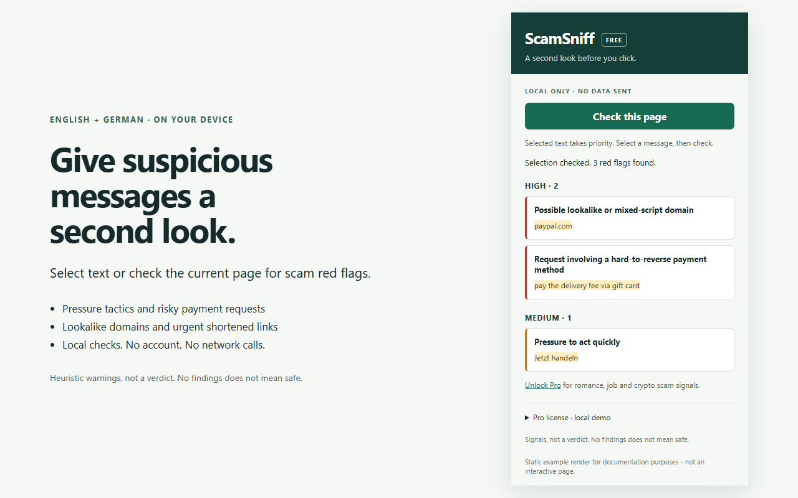

# ScamSniff

ScamSniff is a Chrome/Edge Manifest V3 extension that gives suspicious messages a second look. Select text or scan a page to find English and German red flags: pressure tactics, lookalike domains, risky payment requests, generic requests for sensitive information, and urgent shortened links.

Detection runs entirely on your device. There is no backend, telemetry, remote model, payment request, or external network call in the extension. Findings are heuristic signals, not a determination that a message is fraudulent; no findings does not mean a page is safe.

## Demo



## Install for development

1. Open `chrome://extensions` or `edge://extensions`.
2. Enable **Developer mode**, click **Load unpacked**, and select `C:\Dev\personal\scamsniff\extension` (the **extension** directory, not the project root).
3. Pin ScamSniff, open a regular website, optionally select some text, open the popup, and click **Check this page**.
   Alternatively, right-click selected text and choose **Check selection for ScamSniff** to show a local notification with a summary of all detected rule IDs.
4. After editing files, reload the extension on the extensions page and refresh the target tab.

There is no build step and npm is not required to load the extension. To develop and run tests, use Node 22.12+:

```sh
npm ci
npm test
npm run test:watch
```

## Rule packs and Pro gating

`extension/engine/rules.js` exports structured entries with `id`, `severity`, `reason`, `tier: "free" | "pro"`, and `match(text)`. Match functions return `{ index, snippet }` values referencing the original text. Add new entries or pass a composed pack to `analyze(text, rules)`; the engine has no DOM, Chrome, or Node dependencies.

`analyze()` always evaluates every tier and returns `{ id, reason, severity, tier, snippet, index }` findings. `visibleFindings()` filters the evaluated results for display, defaulting to free. The three Pro entries detect romance plus money requests, job offers plus upfront fees, and crypto plus guaranteed-return claims. Related signals must occur within a roughly 300-character window. Each rule emits one finding except the domain rule, which emits up to 20. Input is limited to its first 200,000 UTF-16 code units; the popup reports truncation.

The popup stores only `licenseKey` in `chrome.storage.local`. `engine/license.js` checks the format `SS-PRO-XXXXXXXX-HHHH`: eight uppercase alphanumeric payload characters and a four-digit hexadecimal checksum. The checksum starts at zero and updates as `(sum * 31 + characterCode) % 65536`. Case and outer whitespace are normalized. This is an intentionally forgeable local demonstration, **not proof of purchase or secure licensing**.

Try this demo key under **Pro license · local demo**:

```text
SS-PRO-DEMO2026-C165
```

Generate another with:

```sh
node --input-type=module -e "import {createDemoKey} from './extension/engine/license.js'; console.log(createDemoKey('TEST2026'))"
```

Unlocking or removing a key immediately re-filters any current results. Invalid keys never unlock Pro. A small unlock line appears only when free findings are visible.

## Privacy and permissions

Read the standalone [privacy policy](https://jevgenijostin.github.io/scamsniff/store/privacy-policy.html). Store copy and upload instructions are in [store/listing.md](store/listing.md); `npm run package` creates ready-to-upload Chrome/Edge and Firefox ZIPs in `dist/` (Windows PowerShell, no dependency installation or build required).

- `activeTab` grants temporary access when you invoke the extension; there are no permanent host permissions or always-on page scanners.
- `scripting` injects an idempotent content script into the active tab's top frame for popup checks or the clicked frame for context-menu checks. A message requests the current selection or `document.body.innerText` on demand.
- `storage` persists the demo license locally. Page text and results are never written to extension storage.
- `contextMenus` adds **Check selection for ScamSniff** when text is selected. A module service worker runs the same local engine against only that selection.
- `notifications` displays the selection summary, including all rule tiers. Notifications may remain in the system notification center until dismissed.
- All scripts and styles ship with the extension. The popup's content security policy includes `connect-src 'none'`. There are no fetch, analytics, remote assets, or external service calls in extension code.

Package installation and GitHub Actions use the network for development dependencies; neither is part of the installed extension. Chrome/Edge itself and the websites you visit have their own network behavior.

## Limitations and manual checks

Use the popup's explicit check action, with selection taking priority, or the selection-only context-menu entry. Checks do not run automatically on selection changes. The popup reads rendered top-frame text, not link destinations, cross-origin frames, images/OCR, shadow-root contents, or form field values. `innerText` omits ordinary hidden content but is not a pixel-visibility detector. Context-menu checks preserve the clicked selection if it changes or content-script injection fails. Browser-internal pages, extension stores, and built-in PDF viewers restrict injection; local files need the browser's file-access toggle.

Domain matching is a small spelling/confusable heuristic, not a reputation database, full Unicode confusable analysis, or punycode decoder. Warnings may flag benign examples or negated statements. Rules do not establish intent or exhaustively understand either language.

The Node suite tests positive/negative examples for all eight rules, mixed languages, matching offsets, repeated calls, limits, custom packs, filtering and licenses. Browser UI automation is deliberately out of scope. Manual smoke checklist:

1. Scan selected text containing `Act now, pay via gift card at paypaI.com`; expect high and medium groups with highlighted excerpts.
2. Clear the selection and scan a normal page; confirm page mode and that old results disappear.
3. Scan `My love, send me money`; free mode hides the Pro finding. Enter the demo key and confirm it appears without rescanning; remove the key and confirm it disappears.
4. Reopen the popup to verify license persistence; try an invalid key and a restricted browser page.
5. Select an HTML-looking payload and confirm it displays as text, not executable markup.
6. Right-click selected text containing `Act now, pay via gift card at paypaI.com`, choose **Check selection for ScamSniff**, and confirm a notification lists three red flags. Repeat with harmless text and expect no red flags; surrounding page text must not affect the result.

## License

MIT. See [LICENSE](LICENSE).
